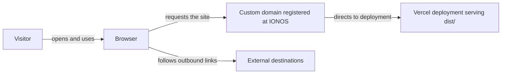
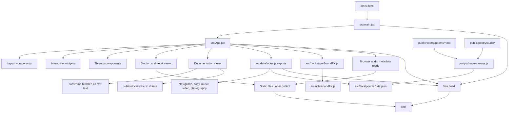

# Architecture and Data Flow

## System context

The browser loads a static React site. Visitors interact with portfolio sections and media; the application reads bundled JavaScript/JSON data and files served from `public/`. There is no application backend, database, or first-party API in this architecture. External destinations, such as streaming links, are ordinary outbound links.

## Application components

## Runtime responsibilities

- `src/main.jsx` mounts `App` inside React Strict Mode.
- `src/App.jsx` owns the active section, catalog/detail selections, transition phase, and playback state. It chooses which view to render and passes handlers and data to child components.
- `src/components/layout/` contains `CornerFrame.jsx`, `SubPageCornerFrame.jsx`, and `Navbar.jsx`; these own the shared frame, detail-view frame, and section navigation.
- `src/components/three/` contains the home scene, reusable geometry, particle, glass-sphere, and Fresnel components. `src/components/widgets/` contains the welcome screen, cursor, mini player, Markdown viewer, and Mermaid renderer.
- `src/views/` contains the section views and the documentation hub: `DocsCatalogView.jsx`, `DocsMarkdownView.jsx`, and `DocsJsDocView.jsx`.
- `src/data/index.js` exports the navigation, copy, and active media data modules, along with the generated poem JSON.
- The section views render catalogs and details. Media and Markdown files are addressed by paths under `public/`, which Vite serves from the site root.
- `src/hooks/useSoundFX.js` coordinates sound effects with application state; `src/utils/soundFX.js` implements the browser audio effects.
- `DocsMarkdownView.jsx` imports the three files under `docs/` as bundled raw text. `DocsJsDocView.jsx` embeds the generated API reference from `public/docs/jsdoc/` in an iframe.
- `App` reads audio metadata in the browser to populate track durations and embedded cover art where available. Playback itself uses the browser audio element/API.
- `scripts/parse-poems.js` is a build-time content tool, not a server endpoint. It reads poem Markdown and optional matching audio filenames, then writes `src/data/poemsData.json`.

## Build and hosting boundary

`npm run build` creates the static production output in `dist/`; `npm run preview` serves that output locally. `npm run build:jsdoc` generates the API reference under `public/docs/jsdoc/` and applies its stylesheet; the site embeds that output in the documentation view. Vercel publishes the built `dist/` output, and the site's IONOS-registered domain directs visitors to that Vercel deployment. The checked-in `vercel.json` names `dist` as the output directory but does not define build, install, or development commands. This repository does not establish whether Vercel receives the build through a connected Git integration or a manual/prebuilt upload, and it does not specify the DNS records.

## Keeping this page accurate

Update the diagrams when the app gains a new section, data source, backend/API, build-time content step, or hosting boundary. Keep arrows tied to actual imports, fetches, and browser behavior. When adding a component, place it in the matching `src/components/` group and update the responsibilities above if it adds a new runtime role.
