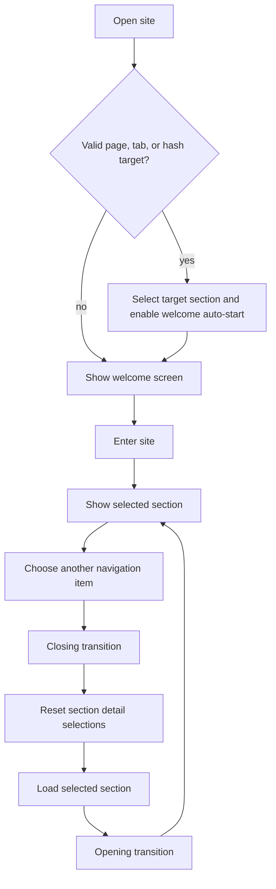
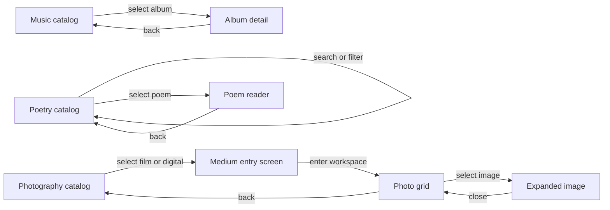
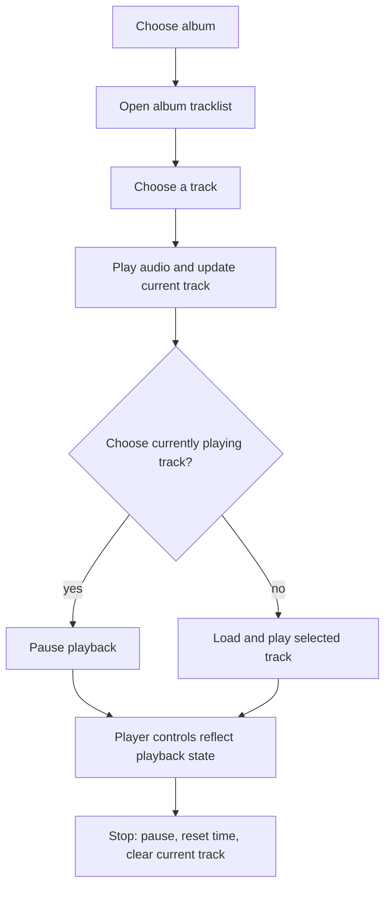
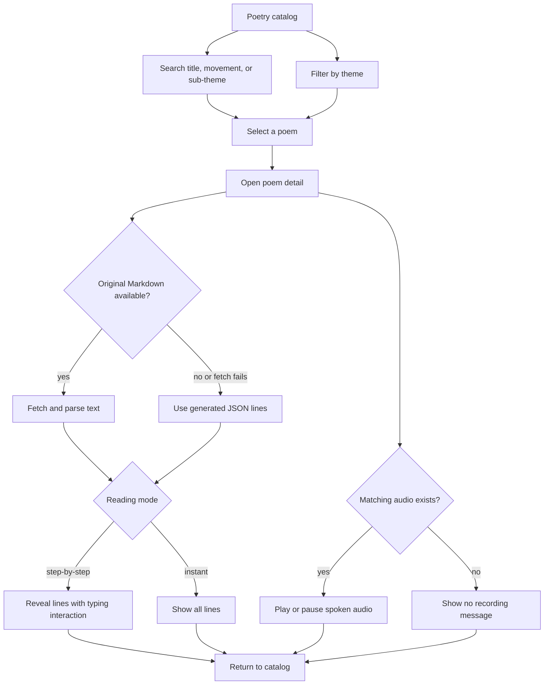
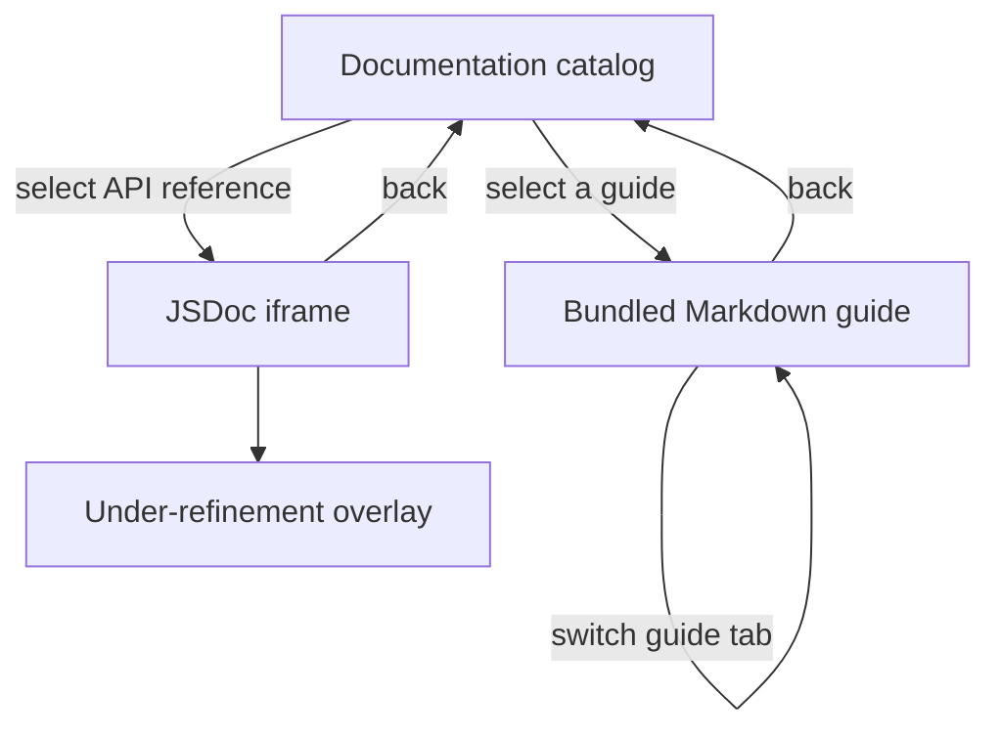

# User Flows

These diagrams describe the current implementation. Videography is shown as deferred because its view currently places a “coming soon” overlay over the player interface.

## Entry and section navigation

Deep links are read once on initial mount. The app accepts `?page=...`, `?tab=...`, or a hash such as `#poetry` for the known section keys: `home`, `music`, `videography`, `poetry`, `photography`, and `links`.

## Catalog and detail patterns

## Music playback

Playback is controlled by browser audio APIs. A floating player is shown outside the music section, and on the music section in mobile landscape. Selecting a poem or starting its spoken audio stops the music player first.

## Poetry reading

## Videography status

The videography data and player interactions exist in the code, but the current view renders a blocking “FILM REELS COMING SOON” overlay. Treat the section as deferred/unavailable to visitors until that overlay is intentionally changed. Once available, the underlying controls support previous/next video, playback, dossier content, and progress seeking.

## Documentation hub

The three Markdown guides are bundled from `docs/` and shown in tabs by `DocsMarkdownView.jsx`. The JSDoc API reference is generated into `public/docs/jsdoc/` and embedded by `DocsJsDocView.jsx`; its iframe is intentionally dimmed and non-interactive while the guide is being refined. The guide header and back-to-catalog control remain available.
